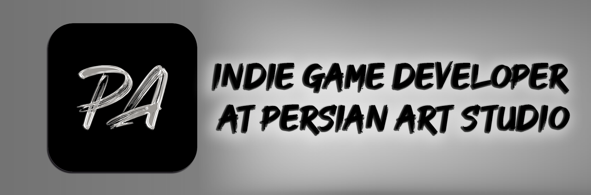
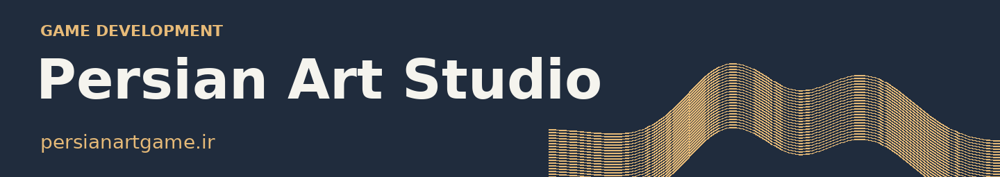

[English](./README.md)　·　[فارسی](./README.fa.md)

## دانیال جماعتی

در **پرشین آرت** با Unreal Engine 5 بازی می‌سازم. بخشی از کارم طراحی رفتار شخصیت‌ها و حرکت دوربین با Blueprint است. در کنار بازی‌سازی، با PHP و Python پلتفرم‌های وب توسعه می‌دهم و مدیریت می‌کنم.

### پروژه‌ها

[Persian Art Studio](https://persianartgame.ir) · وب‌سایت رسمی استودیو؛ بازی‌ها، اخبار و تازه‌های تیم پرشین آرت.

[Vonava](https://vonava.ir) · پلتفرم گفت‌وگوی صوتی با کانال‌های گروهی، چت و اشتراک صفحه.

[Netdoor](https://netdoor.ir) · فروشگاه گیفت‌کارت و اشتراک دیجیتال با انتخاب ریجن و قیمت‌گذاری چندارزی.

**ابزارهای من** · Unreal Engine 5 · Blueprints · PHP · Python · Docker

